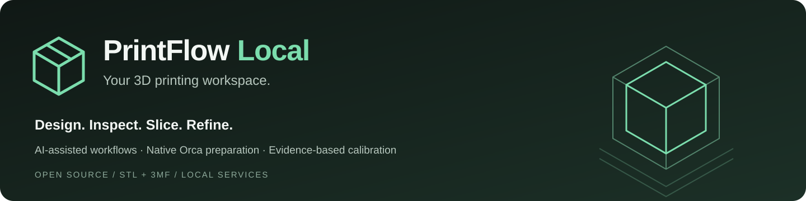
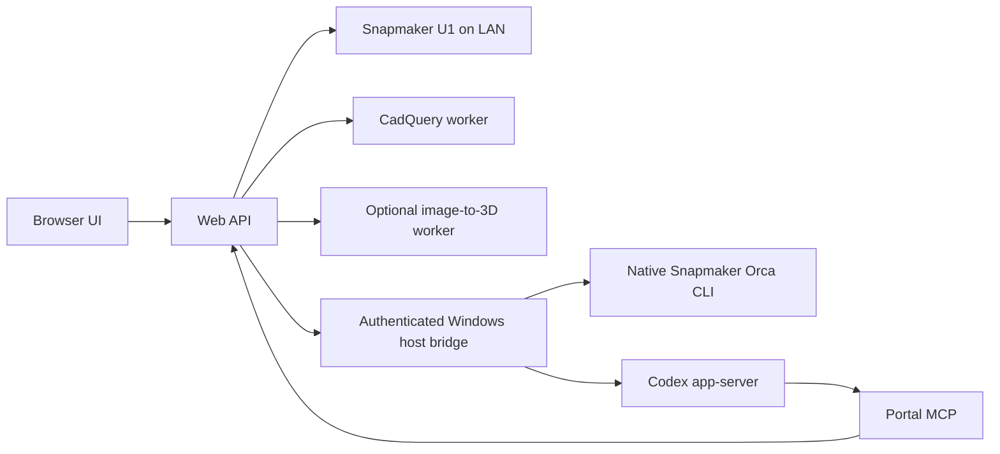

# PrintFlow Local



<p align="center">
  <strong>A local workspace for 3D models, AI-assisted preparation and Snapmaker U1 printing.</strong><br><br>
  <a href="docs/GETTING_STARTED.md">Install PrintFlow</a> ·
  <a href="docs/CODEX_SETUP.md">Connect Codex</a> ·
  <a href="docs/SLICER_AND_CALIBRATION.md">Slicer MCP &amp; calibration</a> ·
  <a href="docs/SCREENSHOTS.md">Screenshot tour</a>
</p>

Bring STL and 3MF files into one library, inspect colors and plates, prepare native
Snapmaker Orca projects, review emitted toolpaths, and start a reviewed job.
PrintFlow connects model creation, calibration and printer monitoring in a browser.

**Status: experimental, version 0.3.0.** The working printer adapter targets the
Snapmaker U1 with official firmware. Other printers currently support assembly
planning and export, not direct printing. This is an independent community project,
not an official Snapmaker, Bambu Lab, Prusa or OpenAI product.

## A conversation, a model, a reviewable print

Ask for a supported design, inspect it in 3D, refine its dimensions or native
color slots, and prepare it with your actual printer and material in mind.
The assistant can run native slicing jobs through MCP, explain its choices and
compare alternatives while keeping a reviewable project for you.


*The real PrintFlow interface in a read-only documentation workspace. Conversation,
service status and history are staged examples; model geometry comes from existing
local files. See [capture details and attribution](docs/SCREENSHOTS.md).*

## Explore the workspace

<table>
  <tr>
    <td width="50%"><strong>A visual home for your models</strong><br><br>
      <a href="docs/screenshots/library.jpg"></a><br>
      Browse real geometry, organize folders and see dimensions and configured colors before opening a model.
    </td>
    <td width="50%"><strong>Colors you can inspect and revise</strong><br><br>
      <a href="docs/screenshots/model-colors.jpg"></a><br>
      Review native 3MF slots, create color revisions and validate the prepared tools against connected-printer material data.
    </td>
  </tr>
  <tr>
    <td><strong>Dimensioned parts with editable revisions</strong><br><br>
      <a href="docs/screenshots/design-studio.jpg"></a><br>
      Use supported CadQuery templates, target a printer and retain STEP, parameters and regeneration source.
    </td>
    <td><strong>From an object image to local geometry</strong><br><br>
      <a href="docs/screenshots/image-to-3d.jpg"></a><br>
      Select a reference, remove its background locally and reconstruct with TripoSR. Inspect the result before printing.
    </td>
  </tr>
  <tr>
    <td><strong>Review the paths that will be printed</strong><br><br>
      <a href="docs/screenshots/sliced-print-preview.jpg"></a><br>
      See actual sliced paths, supports and adhesion structures, with estimated time and material. Physical finish is not simulated.
    </td>
    <td><strong>Calibrate, record and improve</strong><br><br>
      <a href="docs/screenshots/calibration-tests.jpg"></a><br>
      Choose Benchy or a focused test, add evidence and refine reusable profiles through a revision history.
    </td>
  </tr>
</table>

## Your assistant has slicer tools

The **PrintFlow portal MCP** coordinates the library, design workers, preparation
jobs and calibration records. The **native U1 slicer MCP** inspects saved projects
and runs the installed Snapmaker Orca CLI. The assistant can operate that slicing
workflow on your behalf and return results to the browser.

Its preparation loop is **inspect → propose → compare → slice → review**. It
considers actual filament, geometry, placement, supports, brim and compatible
profiles, then compares two to four deliberate variants. Native painting, tool
assignments and priming remain part of the reviewed project. The bridge exposes
supported settings rather than arbitrary control of every GUI option.

**Open original** keeps the source's saved settings. **Prepare model** applies
supported selections to a copy. **Compare quality** produces alternative jobs.
**Print image** shows emitted paths. **Print** remains a separate, explicit action.
Unsaved Orca GUI edits must be saved before file-based tools can inspect them.
Read [how slicing and calibration work](docs/SLICER_AND_CALIBRATION.md).

## Calibration that builds reusable profiles

Start with the original Benchy, then choose a focused test for overhangs, bridges,
first layers, stringing, dimensions, fit or support removal. Native calibration
sweeps remain available through their supported Orca/printer procedures.

After printing, record photos, measurements and physical observations. The AI can
help interpret visible defects and choose the next test. A profile keeps that
evidence and its revisions so you can refine it rather than start over each time.
Matching considers the printer, hotend, actual filament and intended use.

Goal percentages represent confirmed checklist results, not an invented quality
rating. Successful slicing alone does not prove finish, strength or easy support
removal. See the [calibration walkthrough](docs/SLICER_AND_CALIBRATION.md#calibration-is-a-loop).

## Features

| Workspace | Capabilities |
| --- | --- |
| **Library** | Local STL/3MF storage, folders, thumbnails, interactive geometry, plate selection and configured colors. |
| **Print preparation** | Native U1 project copies, material/tool checks, geometry-informed recommendations and comparisons of two to four slicer variants. |
| **Print preview** | Static plate/axonometric images and layer views from emitted G-code, including supports, brim and prime tower. |
| **Printer dashboard** | Live U1 state, temperatures, progress, stock camera snapshots and estimated spool tracking. |
| **Codex chat** | Streamed responses, tool activity, action approvals and links to generated models and prepared jobs. |
| **Calibration** | Benchy and categorized test coupons, photos and measurements, evidence-based goals and versioned profiles. |
| **Design studio** | Parametric CAD templates and editable revisions; optional local image-to-3D reconstruction. |
| **Assemblies** | Split suitable closed solids into build-volume-sized sections for sequential printing or export to multiple printers. |
| **Discover models** | Search supported public model sources and import available files with provenance. |

Generating, opening or slicing a model **does not start a print**. Starting is a
separate action that checks printer availability, materials and tool assignments,
and requires confirmation that the build plate has been cleared for that job.

## Requirements at a glance

| Component | When you need it |
| --- | --- |
| Windows host + Python 3.12+ | Native Orca/Codex bridge and the simplest local installation. |
| Official Snapmaker Orca with U1 profiles | Native preparation and comparisons. |
| Codex CLI + your own account access | AI chat and tool orchestration; account credentials stay on Windows. |
| Modern browser with WebGL | Library and interactive model viewing. |
| U1 on the local network | Live monitoring and explicit printer actions. |
| Separate CAD worker | Editable supported templates and generated test coupons. |
| Optional image worker + pinned model weights | Local image-to-3D; CPU works, AMD acceleration requires target validation. |
| Docker Engine + Compose | Optional separate-service deployment; native Windows bridge is still required. |

GPU hardware is not required for browsing or parametric CAD. Memory and storage
needs scale with model complexity and worker settings; no certified universal
minimum is claimed. [Full requirements and installation](docs/GETTING_STARTED.md).

## Quick start on Windows

Prerequisites:

- Windows with **Python 3.12 or newer**, available as `python`.
- Official **Snapmaker Orca** with U1 profiles for native preparation.
- **Codex CLI**, signed in with `codex login`, for the assistant integration.
- A U1 reachable on the local network for monitoring and printing.

```powershell
git clone https://github.com/dliratx/printflow-local.git
cd printflow-local
.\install.ps1 -Mode Native -WithCad
```

Open **http://127.0.0.1:8840** and add your printer using its LAN address.
The installer creates separate Python environments for the portal and CAD worker.
It does not install firmware, start a print or assume which filament is loaded.

Validate the installed native slicer before relying on preparation results:

```powershell
.\.venv\Scripts\python.exe tools\validate_bridge.py
```

This integration check generates test files and runs the installed slicer; it does
not contact a printer. Run it again after updating Snapmaker Orca.

Follow the [step-by-step installation guide](docs/GETTING_STARTED.md) and
[connect Codex](docs/CODEX_SETUP.md) for the first setup. For containers, CPU
reconstruction, startup registration and AMD prerequisites, use the
[advanced installation guide](INSTALL.md). Read
[maintenance and recovery](MAINTENANCE.md) before updating an existing installation.

## Architecture



Web, portal MCP, CAD and optional image-to-3D are separate services with Docker
Compose definitions and persistent state/model mounts. The native Orca and Codex
bridge remains on Windows. Docker Engine in WSL2 is supported by the installer;
Docker Desktop is optional. See [deployment details](INSTALL.md).

The browser does not receive Codex account credentials. Computer Use is not a
runtime dependency. The bridge operates on saved project files and the native
slicer CLI; it does not synchronize unsaved edits from Orca's GUI.

## Documentation

| Guide | Contents |
| --- | --- |
| [Get started](docs/GETTING_STARTED.md) | Requirements, installation, connection checks and your first model. |
| [Connect Codex](docs/CODEX_SETUP.md) | Sign-in, integrated chat, optional CLI MCP registration and troubleshooting. |
| [Slicer MCP and calibration](docs/SLICER_AND_CALIBRATION.md) | Automated native slicing, tuning decisions, benchmarks and profile refinement. |
| [Screenshot tour](docs/SCREENSHOTS.md) | Full-size images, workflow captions and capture provenance. |
| [Installation](INSTALL.md) | Native Windows, containers, host connectivity, CPU/AMD prerequisites and configuration. |
| [Workflows](docs/WORKFLOWS.md) | Library, colors, preparation, calibration, profiles, assemblies and model discovery. |
| [Architecture and data](docs/ARCHITECTURE.md) | Service boundaries, source map, persistent files and request flow. |
| [Maintenance](MAINTENANCE.md) | Updates, health checks, private backups, restoration and slicer revalidation. |
| [Contributing](CONTRIBUTING.md) | Development setup, test commands and contribution expectations. |
| [Security](SECURITY.md) | Local deployment boundaries, credential handling and private reports. |
| [Third-party notices](THIRD_PARTY.md) | Dependency licenses, vendored source and model provenance. |

## Validation and limitations

Automated tests cover API/workflow behavior, approval routing, project preservation,
geometry/preview handling, G-code rendering, material checks and browser-side state
logic. Native U1 slicing and CPU image reconstruction have also been exercised
during development. These do not establish physical print quality or guarantee
results on another installation.

- **Finish and supports:** settings are candidates, not a guarantee of a perfect
  surface or easy removal. Calibrate with the actual printer and filament.
- **Colors:** configured 3MF colors differ from tools used in emitted G-code.
  STL does not carry material assignments.
- **Image-to-3D:** single-image reconstruction cannot reliably recover unseen
  geometry. General semantic editing and automatic four-tool segmentation are
  not implemented; identity likeness is not guaranteed.
- **GPU:** AMD deployment profiles are provided. Hardware detection is not
  inference validation; verify the worker and a real generation on the target.
- **Containers:** definitions and maintenance tests are included. Container
  builds, rollout/rollback and AMD inference still need target-environment
  validation; they are not claimed as end-to-end validated here.
- **Camera:** official U1 snapshots run at approximately one frame per second.
- **Discovery:** search coverage is partial. Login, thumbnail and download
  restrictions are controlled by each source.
- **Other printers:** export-only until a compatible adapter is implemented.

## Development

Unit tests do not need a connected printer:

```powershell
python -m venv .venv
.\.venv\Scripts\python.exe -m pip install -r requirements-web.txt
.\.venv\Scripts\python.exe -m pip install -e 'vendor/snapmaker-u1-mcp[test]'
.\.venv\Scripts\python.exe -m pytest tests -q -p no:cacheprovider
node --test tests/*.test.cjs
```

Node.js 22 or newer runs the JavaScript tests; the frontend has no npm build step.
CAD checks use a separate environment. See [Contributing](CONTRIBUTING.md) for
the full checks and the optional GitHub Actions workflow template.

## Local data and publication

Personal models, generated jobs, conversations, printer addresses, tokens and
calibration evidence stay in ignored runtime folders. Never publish your `.env`,
`.runtime/`, `runs/`, `weights/` or private backups. The source packager uses an
allowlist rather than copying the working directory:

```powershell
.\.venv\Scripts\python.exe tools\package-source.py
```

The only bundled model is the unmodified, attributed **3DBenchy** benchmark;
its current official license is CC0. No personal models or conversations are
included. See [third-party notices](THIRD_PARTY.md).

## License and acknowledgments

PrintFlow's own source is released under the [MIT license](LICENSE). Third-party
components retain their licenses. Codex/ChatGPT is an external account service
with separate terms; the entire deployment is not relicensed as MIT.

The native bridge builds on
[JSCodesTech/snapmaker_u1_mcp](https://github.com/JSCodesTech/snapmaker_u1_mcp),
with its upstream license retained. Thanks to the Snapmaker, OrcaSlicer, CadQuery,
TripoSR and [3DBenchy](https://www.3dbenchy.com/) projects.
