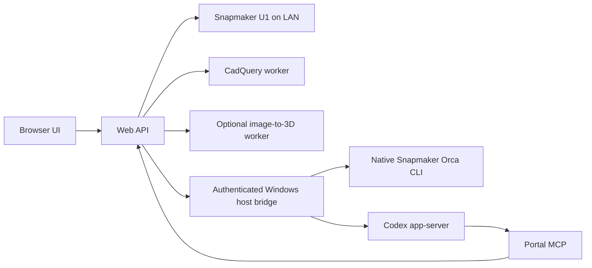

# PrintFlow Local

**A local workspace for 3D models, AI-assisted preparation and Snapmaker U1 printing.**

Bring STL and 3MF files into one library, inspect colors and plates, prepare native
Snapmaker Orca projects, review emitted toolpaths, and start a reviewed job.
PrintFlow connects model creation, calibration and printer monitoring in a browser.

**Status: experimental, version 0.3.0.** The working printer adapter targets the
Snapmaker U1 with official firmware. Other printers currently support assembly
planning and export, not direct printing. This is an independent community project,
not an official Snapmaker, Bambu Lab, Prusa or OpenAI product.

## Features

| Workspace | Capabilities |
| --- | --- |
| **Library** | Local STL/3MF storage, folders, thumbnails, interactive geometry, plate selection and configured colors. |
| **Print preparation** | Native U1 project copies, material/tool checks, geometry-informed recommendations and comparisons of two to four slicer variants. |
| **Print preview** | Static plate/axonometric images and layer views from emitted G-code, including supports, brim and prime tower. |
| **Printer dashboard** | Live U1 state, temperatures, progress, stock camera snapshots and estimated spool tracking. |
| **Codex chat** | Streamed responses, tool activity, action approvals and links to generated models and prepared jobs. |
| **Calibration** | Benchy and categorized test coupons, photos and measurements, evidence-based goals and versioned profiles. |
| **Design studio** | Parametric CAD templates and editable revisions; optional local image-to-3D reconstruction. |
| **Assemblies** | Split suitable closed solids into build-volume-sized sections for sequential printing or export to multiple printers. |
| **Discover models** | Search supported public model sources and import available files with provenance. |

Generating, opening or slicing a model **does not start a print**. Starting is a
separate action that checks printer availability, materials and tool assignments,
and requires confirmation that the build plate has been cleared for that job.

## Quick start on Windows

Prerequisites:

- Windows with **Python 3.12 or newer**, available as `python`.
- Official **Snapmaker Orca** with U1 profiles for native preparation.
- **Codex CLI**, signed in with `codex login`, for the assistant integration.
- A U1 reachable on the local network for monitoring and printing.

```powershell
git clone https://github.com/dliratx/printflow-local.git
cd printflow-local
.\install.ps1 -Mode Native -WithCad
```

Open **http://127.0.0.1:8840** and add your printer using its LAN address.
The installer creates separate Python environments for the portal and CAD worker.
It does not install firmware, start a print or assume which filament is loaded.

Validate the installed native slicer before relying on preparation results:

```powershell
.\.venv\Scripts\python.exe tools\validate_bridge.py
```

This integration check generates test files and runs the installed slicer; it does
not contact a printer. Run it again after updating Snapmaker Orca.

For prerequisites, startup registration, containers, CPU reconstruction and AMD
setup, follow the [installation guide](INSTALL.md). For an existing installation,
read [maintenance and recovery](MAINTENANCE.md) before updating.

## Architecture



Web, portal MCP, CAD and optional image-to-3D are separate services with Docker
Compose definitions and persistent state/model mounts. The native Orca and Codex
bridge remains on Windows. Docker Engine in WSL2 is supported by the installer;
Docker Desktop is optional. See [deployment details](INSTALL.md).

The browser does not receive Codex account credentials. Computer Use is not a
runtime dependency. The bridge operates on saved project files and the native
slicer CLI; it does not synchronize unsaved edits from Orca's GUI.

## Documentation

| Guide | Contents |
| --- | --- |
| [Installation](INSTALL.md) | Native Windows, containers, host connectivity, CPU/AMD prerequisites and configuration. |
| [Workflows](docs/WORKFLOWS.md) | Library, colors, preparation, calibration, profiles, assemblies and model discovery. |
| [Architecture and data](docs/ARCHITECTURE.md) | Service boundaries, source map, persistent files and request flow. |
| [Maintenance](MAINTENANCE.md) | Updates, health checks, private backups, restoration and slicer revalidation. |
| [Contributing](CONTRIBUTING.md) | Development setup, test commands and contribution expectations. |
| [Security](SECURITY.md) | Local deployment boundaries, credential handling and private reports. |
| [Third-party notices](THIRD_PARTY.md) | Dependency licenses, vendored source and model provenance. |

## Validation and limitations

Automated tests cover API/workflow behavior, approval routing, project preservation,
geometry/preview handling, G-code rendering, material checks and browser-side state
logic. Native U1 slicing and CPU image reconstruction have also been exercised
during development. These do not establish physical print quality or guarantee
results on another installation.

- **Finish and supports:** settings are candidates, not a guarantee of a perfect
  surface or easy removal. Calibrate with the actual printer and filament.
- **Colors:** configured 3MF colors differ from tools used in emitted G-code.
  STL does not carry material assignments.
- **Image-to-3D:** single-image reconstruction cannot reliably recover unseen
  geometry. General semantic editing and automatic four-tool segmentation are
  not implemented; identity likeness is not guaranteed.
- **GPU:** AMD deployment profiles are provided. Hardware detection is not
  inference validation; verify the worker and a real generation on the target.
- **Containers:** definitions and maintenance tests are included. Container
  builds, rollout/rollback and AMD inference still need target-environment
  validation; they are not claimed as end-to-end validated here.
- **Camera:** official U1 snapshots run at approximately one frame per second.
- **Discovery:** search coverage is partial. Login, thumbnail and download
  restrictions are controlled by each source.
- **Other printers:** export-only until a compatible adapter is implemented.

## Development

Unit tests do not need a connected printer:

```powershell
python -m venv .venv
.\.venv\Scripts\python.exe -m pip install -r requirements-web.txt
.\.venv\Scripts\python.exe -m pip install -e 'vendor/snapmaker-u1-mcp[test]'
.\.venv\Scripts\python.exe -m pytest tests -q -p no:cacheprovider
node --test tests/*.test.cjs
```

Node.js 22 or newer runs the JavaScript tests; the frontend has no npm build step.
CAD checks use a separate environment. See [Contributing](CONTRIBUTING.md) for
the full checks and the optional GitHub Actions workflow template.

## Local data and publication

Personal models, generated jobs, conversations, printer addresses, tokens and
calibration evidence stay in ignored runtime folders. Never publish your `.env`,
`.runtime/`, `runs/`, `weights/` or private backups. The source packager uses an
allowlist rather than copying the working directory:

```powershell
.\.venv\Scripts\python.exe tools\package-source.py
```

The only bundled model is the unmodified, attributed **3DBenchy** benchmark;
its current official license is CC0. No personal models or conversations are
included. See [third-party notices](THIRD_PARTY.md).

## License and acknowledgments

PrintFlow's own source is released under the [MIT license](LICENSE). Third-party
components retain their licenses. Codex/ChatGPT is an external account service
with separate terms; the entire deployment is not relicensed as MIT.

The native bridge builds on
[JSCodesTech/snapmaker_u1_mcp](https://github.com/JSCodesTech/snapmaker_u1_mcp),
with its upstream license retained. Thanks to the Snapmaker, OrcaSlicer, CadQuery,
TripoSR and [3DBenchy](https://www.3dbenchy.com/) projects.
