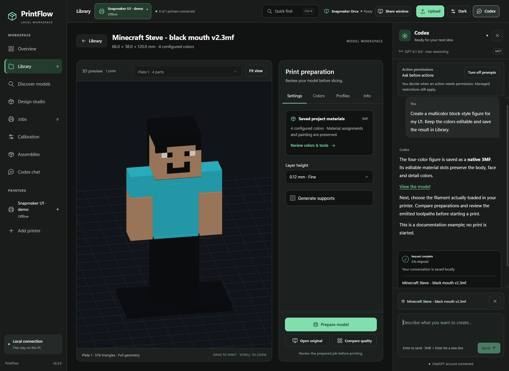

# Connect Codex to PrintFlow

[Start here](GETTING_STARTED.md) · [Slicer and calibration](SLICER_AND_CALIBRATION.md)

There are two routes: use the assistant inside PrintFlow, or add PrintFlow's MCP
tools to a separate Codex CLI session. The web assistant uses the local Codex
app-server on the Windows host. The assistant service requires its own account
access and network connection; it is separate from the local CAD/image engines.

## Install and sign in

Install Codex on the **Windows host running the Orca bridge**, under the same
Windows account. Use the Windows option in the
[official Codex CLI installation guide](https://learn.chatgpt.com/docs/codex/cli).
If Node.js and npm are already installed, the official npm option is:

```powershell
npm install -g @openai/codex
codex --version
```

Open a new PowerShell after installation so it sees the updated PATH. Complete
the browser sign-in yourself, then confirm the active method:

```powershell
codex login
codex login status
```

Use the ChatGPT account you intend to connect. Available sign-in methods and
account restrictions are described in [official authentication documentation](https://learn.chatgpt.com/docs/auth).
Do not paste credentials into PrintFlow chat or copy Codex's authentication cache
into the source or a container.

## Use the integrated web assistant

From the PrintFlow checkout, start the native services:

```powershell
.\tools\start-printflow.ps1
```

Open **http://127.0.0.1:8840**, then choose **Codex**. The host starts Codex's
app-server process, checks the signed-in account and reads its model catalog.
At conversation creation, PrintFlow supplies its portal MCP URL automatically.
You do not need to add the MCP manually just to use the integrated chat.
The transport is based on the [documented app-server interface](https://learn.chatgpt.com/docs/app-server).



*Real PrintFlow interface with a staged example conversation and existing model.
This screenshot is a documentation example, not a new generation benchmark.*

PrintFlow displays the active model and reasoning effort. Available choices come
from the installed Codex session; a listed model does not guarantee account access.
A completed request is the practical connection check. PrintFlow retains its
selection in ignored local preferences. Higher reasoning can increase latency;
use it for difficult design decisions rather than treating it as a print-quality
guarantee.

## Verify the connection

Try these requests in order:

1. **“List the models in my library and the design tools available here.”**
   Expect actual filenames and reported worker capabilities.
2. **“Read my printer status without changing anything.”**
   Expect a tool-backed result, or an explicit offline/unavailable result.
3. **“Inspect this selected model and explain what you would check before slicing.”**
   Expect model/material questions or findings tied to the selected source.

Check that the activity panel reports real steps and the request reaches a final
state. A connected account, an installed MCP entry and a successful tool call
are three different checks.

## Optional: connect a separate Codex CLI session

Keep PrintFlow and the portal MCP running. Register the local Streamable HTTP
endpoint:

```powershell
codex mcp add printflow --url http://127.0.0.1:8842/mcp
codex mcp list
```

Open a new CLI session in the checkout. Use `/mcp` to inspect active servers, then
ask it to list the library using PrintFlow. The commands follow
[official MCP configuration guidance](https://learn.chatgpt.com/docs/extend/mcp?surface=cli).

The optional legacy `snapmaker-u1` server exposes saved native project/slicer
tools. After successful native validation, register it with:

```powershell
.\tools\register_mcp.ps1
```

The portal MCP supplies library, workflow and printer operations. The legacy
server does not itself send a print. Do not confuse the two when choosing tools.

## Containers and another host

Keep Codex sign-in and native Orca on Windows. The web/MCP containers communicate
with the authenticated Windows bridge; Codex account files are not mounted into
them. The MCP URL must be reachable **from the Windows Codex process**.

`PRINTFLOW_MCP_URL` overrides its default `http://127.0.0.1:8842/mcp`. Set it in the
environment that starts the host bridge when your deployment uses another port
or host. WSL/container routing and shared model paths are covered in
[the installation guide](../INSTALL.md). A cloud agent cannot reach your PC's
loopback URL merely by receiving that URL.

## Troubleshooting

| Symptom | Check |
| --- | --- |
| Codex is not found | Run `Get-Command codex` in the same Windows account. Reopen PowerShell after installation. |
| A packaged Codex binary is outside PATH | Set `PRINTFLOW_CODEX_BIN` to its actual executable path before starting the host bridge. |
| Sign-in is missing | Run `codex login status`, complete `codex login`, then restart the host services when idle. |
| Model unavailable | Choose a model exposed by your installed/account-supported catalog and verify a request completes. |
| MCP is listed but tools fail | Check the portal MCP health at `http://127.0.0.1:8842/health`, then inspect an actual tool result. |
| Permission prompt fails | Review the current pending request. An expired prompt cannot authorize a different request. Managed restrictions still apply. |
| Chat works but preparation fails | Check native Orca validation, actual filament, saved project compatibility and the concrete job error. |
| Slow request | Inspect its reported stage. Generation, native slicing and inference are different operations; a quiet period is not measured progress. |

After changing the host environment or Codex executable, restart its idle services
with the documented stop/start tools. Do not interrupt an active printer job to
test sign-in, and never retry physical print starts as a connection test.
