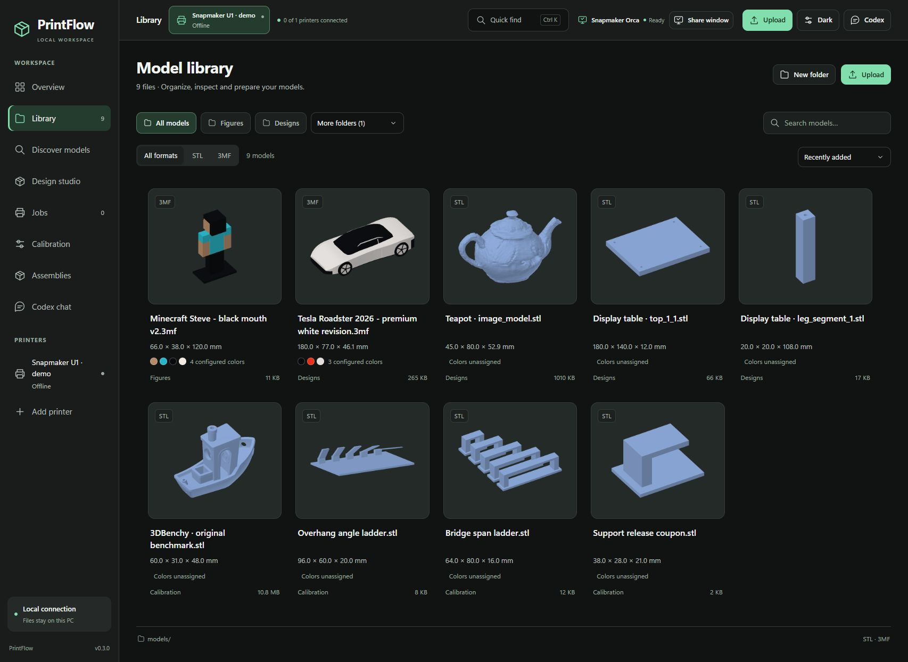
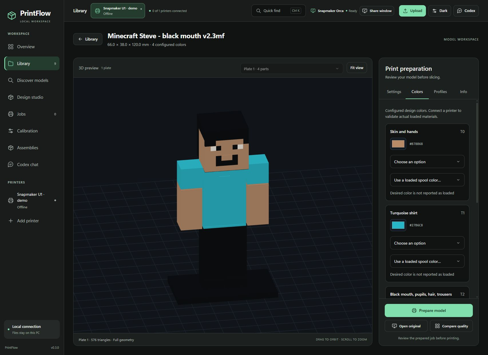
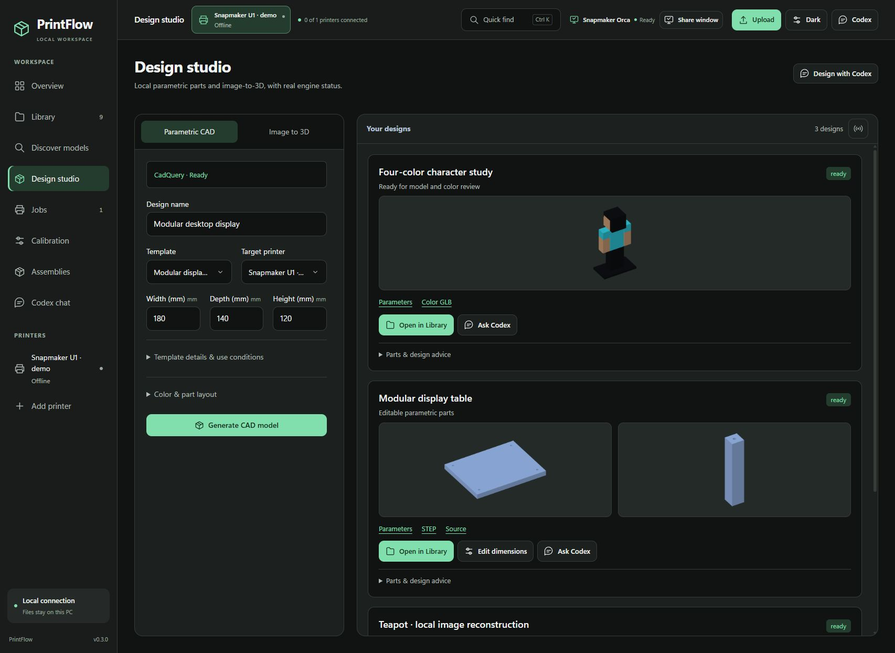
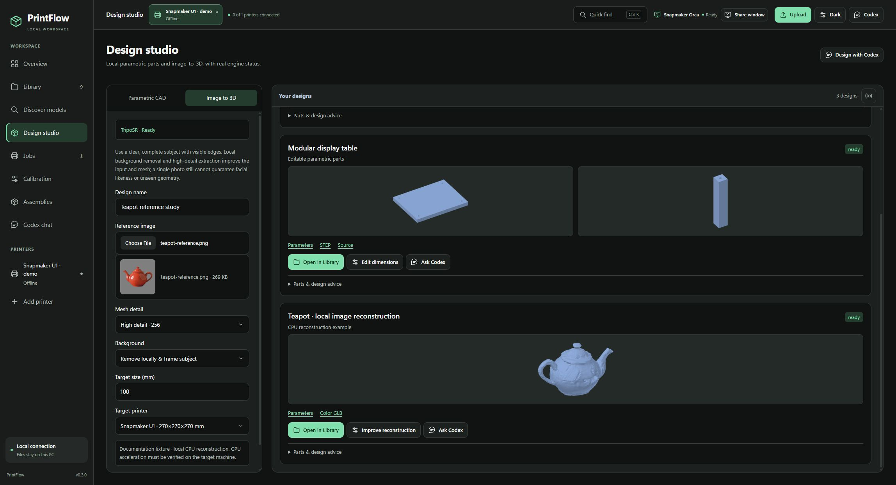
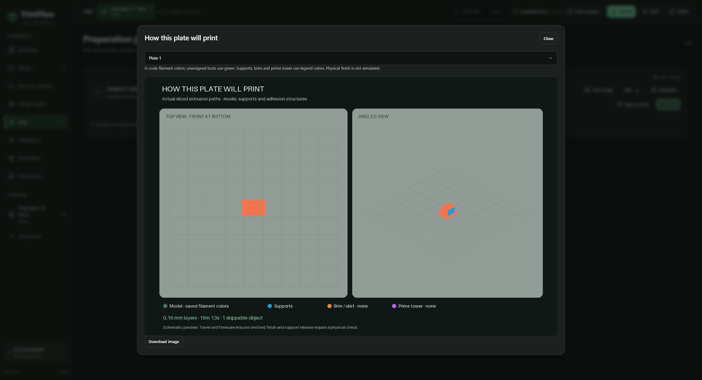
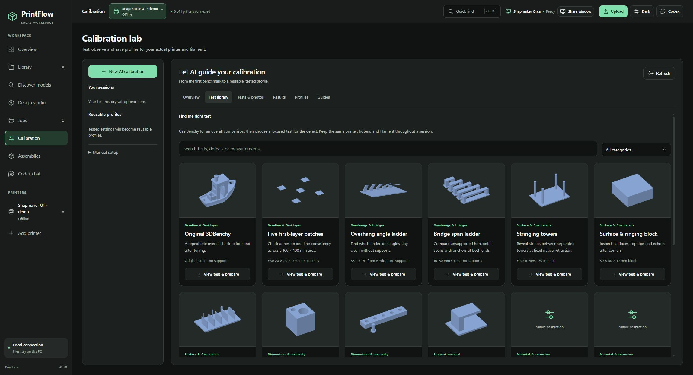

# A visual tour of PrintFlow

[Project overview](../README.md) · [Install](GETTING_STARTED.md) · [Connect Codex](CODEX_SETUP.md)

These captures show the real PrintFlow frontend on October 27, 2026. They were
taken in a separate, read-only documentation workspace. The library uses existing
local geometry; the example conversation, design-history arrangement and service
status are staged fixtures. The print image is generated from an existing native
G-code job. No printer was connected to the capture workspace or commanded by it.
The images do not demonstrate a new AI run or certify physical print quality.

## Library — find the next thing to print

The library brings uploaded models, generated designs and calibration assets
together. Thumbnails represent the actual saved geometry. Format filters, folder
navigation, sorting and dimensions make the next step easier to review.
Configured 3MF colors are different from tools actually used by a sliced plate.

## AI beside your model

The example illustrates a request, a linked native 3MF result and a model already
selected for preparation. The assistant has model and tool context, and its result
card can reopen the model. The conversation is a documentation example, not a
captured inference benchmark. See [connecting Codex](CODEX_SETUP.md).

## Colors — revise while preserving the original

A saved four-color figure shows its existing slots in the same workspace as the
3D view. Color changes create a new revision. Loaded filament and actual emitted
tools must be validated before a print; this disconnected demo does not assert
that the design colors are loaded.

## Design studio — dimensions become editable parts

Supported templates expose dimensions and target-printer constraints. Existing
examples show models that can be reopened in Library and parametric revisions
that retain source/STEP files. A large display table is a prototype requiring fit
and load testing, not certified structural furniture.

## Image to 3D — local reconstruction

Choose a clear object image, extraction quality, background handling and target
size. The teapot geometry shown is from an earlier local CPU reconstruction.
This capture does not establish GPU acceleration or hidden-surface accuracy.
The screenshot's reference comes from the pinned TripoSR example described below.

## Native slicing — inspect the emitted paths

This support coupon was actually sliced in native Orca before capture. The views
show placement and extrusion paths, with supports distinguished from the model.
Time and grams are slicer estimates. Brim/tower absence is reported explicitly;
the image does not simulate surface quality or support-removal effort.

## Calibration — select a test for the defect

The catalog explains what each test evaluates, its nominal geometry and the
intended workflow. Benchy provides an overall baseline; overhang, bridge,
clearance and support-release tests answer more focused questions. Native
parameter sweeps remain clearly distinguished from fixed-parameter coupons.
See [calibration and profile refinement](SLICER_AND_CALIBRATION.md).

## Capture and attribution notes

- Captures are browser screenshots; controls, labels and model views are the real
  application UI. No personal chat history, addresses, tokens or camera images
  are included. Original model files are not distributed with this gallery.
- The Roadster is the project's approximate display study, not manufacturer CAD.
  The block-style character is an illustrative local design. Product/character
  names in screenshots do not indicate endorsement.
- Original 3DBenchy is credited to Daniel Norée / Creative Tools under its current
  CC0 license; see [third-party notices](../THIRD_PARTY.md).
- The reference image in the image-to-3D capture is
  [`examples/teapot.png` from TripoSR](https://github.com/VAST-AI-Research/TripoSR/blob/107cefdc244c39106fa830359024f6a2f1c78871/examples/teapot.png),
  pinned commit `107cefdc244c39106fa830359024f6a2f1c78871`.
  Its SHA-256 is `66b0b8f7dd759e97d20665999885e0548f96c95dadee6bf9762ccd877c596b8c`.
  The upstream [MIT notice](screenshots/TripoSR-LICENSE.txt), copyright 2024
  Tripo AI & Stability AI, is retained beside the screenshots.
